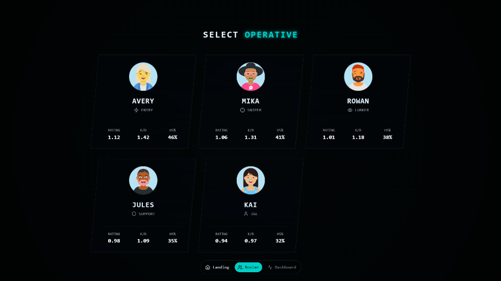
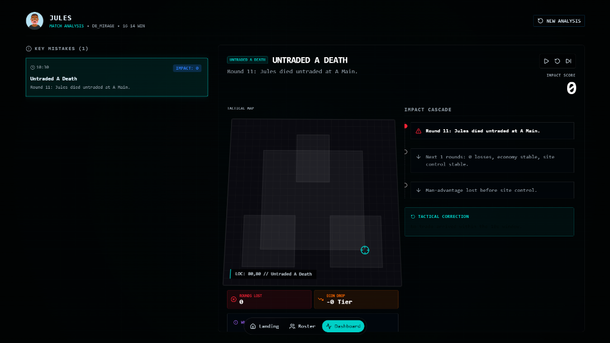
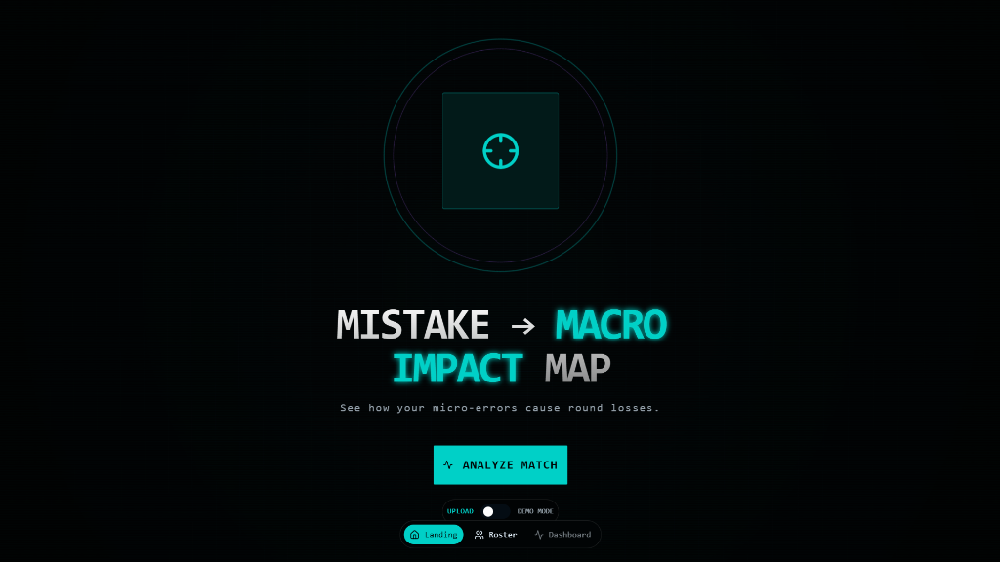
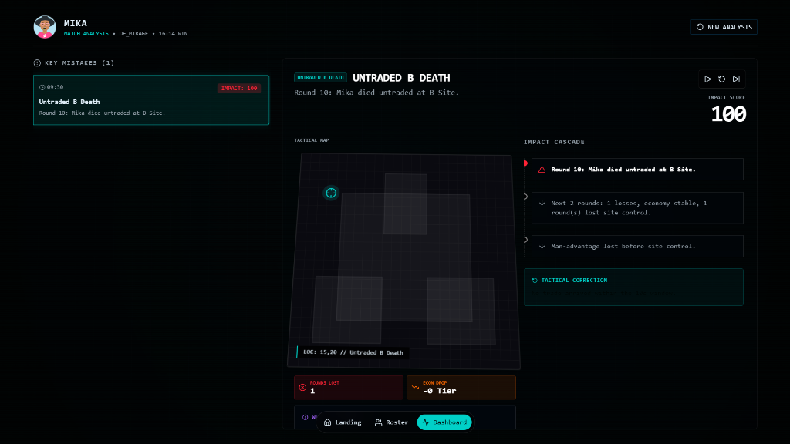

# Mistake → Macro Impact Map

<div align="center">
  <h3>Causality Visualized</h3>
  <p>This isn’t just analytics. It’s the butterfly effect of every micro-error, mapped to round losses.</p>
</div>

<br />

<div align="center">
  
</div>

<br />

## ⚡ Overview

**Mistake → Macro Impact Map** is a next-generation match analysis tool designed to visualize the ripple effects of in-game mistakes. By tracking "micro-errors" and mapping them to their strategic consequences, this tool helps players and coaches understand the *true* cost of every decision.

<div align="center">
  
  
</div>

## 🚀 Key Features

*   **Impact Cascade**: Visualize how a single untraded death spirals into a round loss.
*   **Tactical Correction**: Get actionable feedback on how to prevent the same mistake next time.
*   **Economy & Control Analysis**: See the hidden costs of mistakes on your economy and map control.
*   **Interactive Tactical Map**: Replay the scenario with a tactical 2D map view.

<div align="center">
  
</div>

## 🛠️ Stack

*   **Runtime**: [Bun](https://bun.sh)
*   **Framework**: React 19 + Vite 7
*   **Language**: TypeScript
*   **Styling**: Tailwind CSS 4 (OKLCH colors)
*   **State**: Zustand + React Query
*   **UI**: shadcn/ui (Radix primitives)

## 💻 Setup

1.  **Install dependencies**
    ```bash
    bun install
    ```

2.  **Run the app**
    ```bash
    bun dev
    ```

3.  **Build for production**
    ```bash
    bun run build
    ```

## 🎮 Demo Mode

*   The app runs in **Demo Mode** by default.
*   Trigger an analysis to see the engine in action with mocked match data.

## ☁️ Deployment

Easily deploy to Vercel:
1.  Import this repo.
2.  Set framework preset to **Vite**.
3.  Build command: `bun run build`.
4.  Output directory: `dist`.

---

<div align="center">
  <p>Created by love from M S Abhishek</p>
</div>
